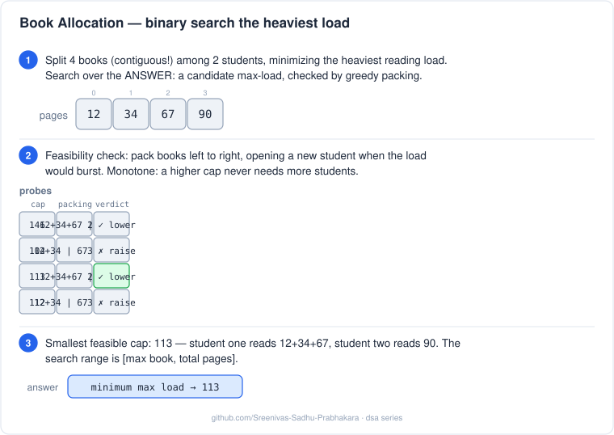

# Allocate Minimum Number of Pages

> Striver SDE Sheet 067 · Day 11 Binary Search — binary search the busiest student's load; a greedy packer checks feasibility of each cap. Go, stdlib only, tested.

## Problem

Books with page counts must be split among s students, each taking a *contiguous* run of books, every book assigned. Minimize the pages of the student who reads the most. The archetypal "minimize the maximum" problem.

## Approach

Binary search on the answer. The predicate "can the books be split so nobody exceeds cap?" is monotone — a bigger cap never hurts — and checkable greedily: walk the books, cram each student until the next book would overflow the cap, then start a new student. Greedy is exact here because contiguity means delaying a split can only help later students. The search runs over [max page, total pages]; the smallest feasible cap is the answer. The same skeleton solves Aggressive Cows (maximize the minimum, flipped) and the split-array/painter problems.

**Complexity:** O(n · log Σpages) time, O(1) space.

## Visual walkthrough

Read the picture top to bottom — each numbered frame is one moment of the algorithm
running on this repo's test example.

## Run

    go test ./...   # verify
    go run .        # demo

---

One of 191 repos solving Striver's SDE Sheet in Go — stdlib only, one problem per repo, every solution tested. Browse the set: [`dsa-*` repos](https://github.com/Sreenivas-Sadhu-Prabhakara?tab=repositories&q=dsa-&type=source).
